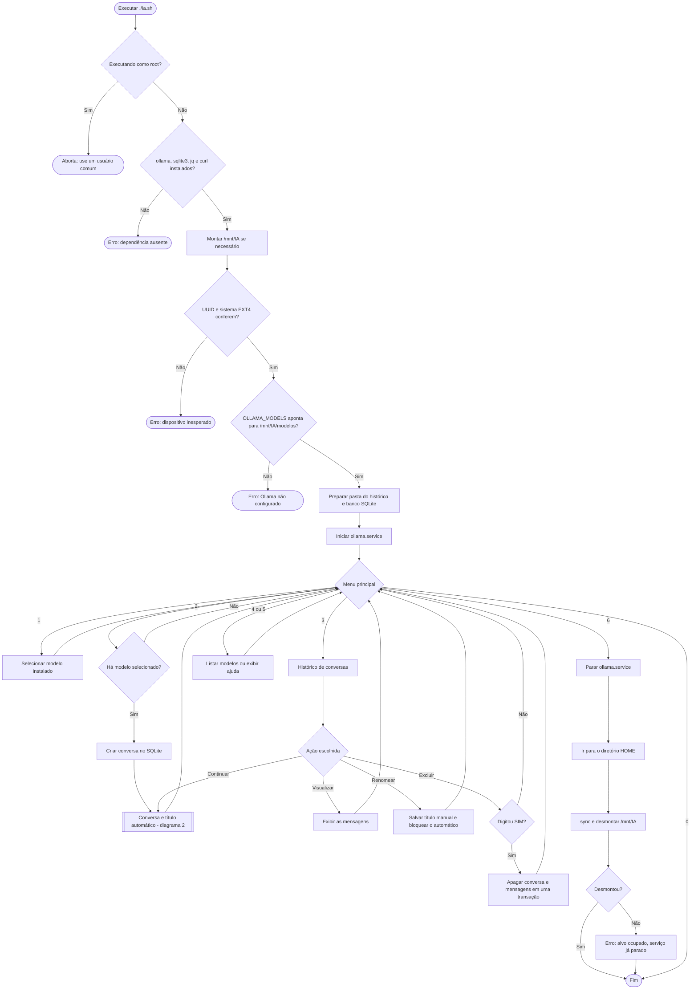
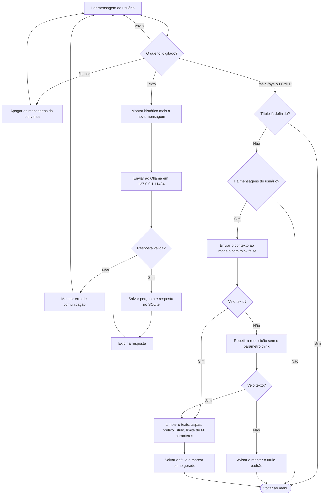

# Fluxograma de funcionamento

Os diagramas abaixo descrevem o fluxo implementado em `ia.sh` e são exibidos automaticamente pelo GitHub.

## 1. Visão geral

Da execução do script até o encerramento: verificações do ambiente, menu principal e as ações de cada opção.

## 2. Conversa e título automático

Cada mensagem é enviada à API local com o histórico da conversa e salva no SQLite. O título é gerado **ao encerrar** a conversa.

